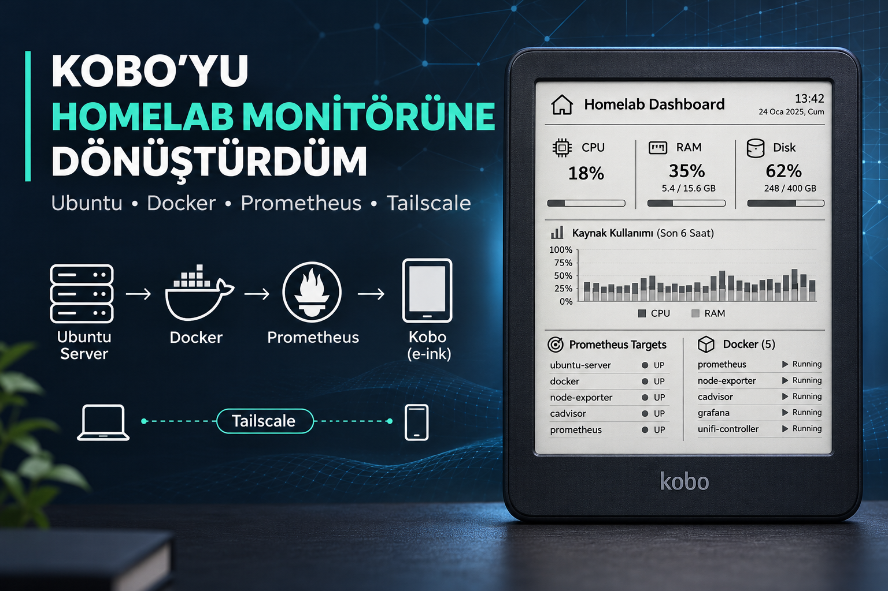

# Kobo Homelab Monitor & WiZ Room Control

Turn a Kobo e-reader into a distraction-free operations and room-control panel. The project combines an e-ink friendly homelab dashboard with local Philips WiZ light control, all served by an Ubuntu host and designed for Kobo's older WebKit browser.

Use the monitoring view to check the server without opening a laptop, then switch to the room-mode view while reading. WiZ commands stay on the local network and do not require the cloud after the bulbs have joined Wi-Fi and local communication has been enabled.



## Kobo and PC interfaces

### Homelab monitoring

- CPU, memory and disk utilization
- Prometheus target summary
- Running, stopped and unhealthy container counts
- Container name, image, state and published ports
- Host uptime, one-minute load and Tailscale service state
- Automatic refresh every 60 seconds
- ES5 and XMLHttpRequest; no frontend build step or external assets
- Read-only interface with no container control actions

### Philips WiZ room control

- Live reachability and state for two allow-listed WiZ lights
- **Reading:** warm white at 2700K and 45% brightness
- **Sleep:** turns both lights off
- **Work:** neutral white at 4000K and 80% brightness
- Three large e-ink friendly choices instead of sliders and dense controls
- Direct local UDP communication with the bulbs on port `38899`
- WiZ bridge has no published host port and accepts only allow-listed commands and devices

### WiZ Studio (PC)

On a modern desktop browser, open `http://<dashboard-host>:8786/lights-desktop.html` on your trusted LAN (use your configured port if different). WiZ Studio uses the same local WiZ bridge as the Kobo page:

- Control either bulb individually or both together.
- Turn lights on or off, set brightness from 10–100%, and adjust white temperature from 2200–6500 K.
- Pick a preset or custom RGB color on compatible bulbs, or apply the Reading, Night or Work preset.
- Check live bulb status; it refreshes every 10 seconds.

The Kobo page at `/lights.html` keeps its three simple room modes and does not require a modern browser.

## Architecture

```text
Kobo browser
   |
   +-- Homelab dashboard --> Nginx --> health endpoint / JSON snapshots
   |
   +-- Room modes ---------> Nginx --> Python WiZ bridge --> UDP 38899 --> WiZ lights

Ubuntu + Docker Compose host
```

## Requirements

- Docker Engine with Compose
- `jq` on the host
- Permission to run read-only Docker CLI commands
- An existing HTTP endpoint returning the health schema below
- A trusted LAN or private overlay network; do not expose this dashboard directly to the public internet
- WiZ local communication enabled for bulbs already joined to the same LAN

## Quick start

```sh
cp .env.example .env
# Edit .env with private, environment-specific values.
chmod +x update-extra.sh
./update-extra.sh
docker compose up -d
```

`WIZ_LIGHTS` stays in the ignored `.env` file. Do not commit real device addresses.

In the WiZ app, enable **Local communication** before starting the bridge. The official app may still be needed for the initial Wi-Fi onboarding, but normal Kobo controls are sent directly over the LAN.

Refresh host and container metadata once per minute:

```cron
* * * * * /path/to/kobo-homelab-monitor/update-extra.sh >/dev/null 2>&1
```

The Docker network configured in `.env` must already exist and be shared with the service behind `STATUS_UPSTREAM`.

## Health endpoint schema

`GET /api/status` must return JSON shaped like:

```json
{
  "status": "ok",
  "cpu_pct": 12.5,
  "ram_pct": 37.2,
  "disk_pct": 48.1,
  "targets_up": "3/3",
  "down_list": "none",
  "checked_at": "2026-01-01T12:00:00Z"
}
```

## Kobo NickelMenu

Copy `nickelmenu.example` to the NickelMenu configuration directory and replace `SERVER_IP` with the dashboard host's private address. The file intentionally contains no real network identifiers.

## Security model

- No credentials, tokens, hostnames or real IP addresses are committed.
- `.env` and generated runtime JSON files are ignored by Git.
- Nginx sets restrictive browser headers and disables caching.
- The monitoring UI is read-only and exposes no Docker control endpoint. The light controls are not authenticated; anyone who can reach the dashboard can control the configured lights. Limit access to trusted devices and do not expose the dashboard publicly.
- The WiZ page can change only the explicitly configured bulbs using a fixed command allow-list.
- The WiZ bridge is reachable only from the shared internal Docker network; it publishes no host port.
- Bind the service only to a trusted private interface and apply firewall rules appropriate to your network.

## License

MIT

